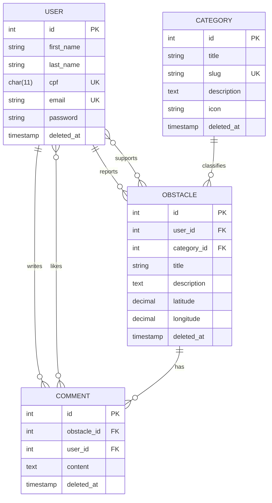

<p align="center">
  
</p>

<h1 align="center">Fluxo Livre</h1>

<p align="center">
  Plataforma colaborativa de mapeamento de obstáculos de acessibilidade urbana.
  <br>
  <em>Collaborative urban accessibility obstacle mapping platform.</em>
</p>

<p align="center">
  
  
  
  
  
</p>

---

## 📖 Sobre / About

**Fluxo Livre** é uma plataforma web que permite a cidadãos reportar e visualizar obstáculos de acessibilidade em espaços urbanos — como calçadas danificadas, rampas ausentes, bloqueios de passagem e problemas de sinalização — diretamente em um mapa interativo.

O projeto nasceu com foco em **Curitiba, PR**, mas pode ser adaptado para qualquer cidade.

**Fluxo Livre** is a web platform that empowers citizens to report and visualize urban accessibility obstacles — such as damaged sidewalks, missing ramps, blocked passages, and signage issues — directly on an interactive map.

---

## ✨ Funcionalidades / Features

| Status | Funcionalidade |
|:------:|----------------|
| ✅ | Cadastro e login com CPF, e-mail e senha (autenticação via token) |
| ✅ | Mapa interativo em tela cheia com geolocalização do usuário |
| ✅ | Reportar obstáculos clicando no mapa (com título, descrição e categoria) |
| ✅ | Visualizar todos os obstáculos reportados (sem necessidade de login) |
| ✅ | Editar e excluir obstáculos próprios |
| ✅ | 7 categorias de obstáculos pré-definidas |
| 🔜 | Apoiar/votar em obstáculos de outros usuários |
| 🔜 | Comentários em obstáculos |
| 🔜 | Curtir comentários |
| 🔜 | Páginas de Informações e Acessibilidade |

---

## 🏗️ Arquitetura / Architecture

O projeto é dividido em dois módulos independentes:

```
fluxo-livre/
├── fluxo-livre-backend/    ← API REST (Laravel + Sanctum)
└── fluxo-livre-frontend/   ← SPA-like estático (HTML + CSS + JS + Leaflet)
```

### Backend

- **Framework:** Laravel 13 (PHP 8.3+)
- **Autenticação:** Laravel Sanctum (Bearer tokens)
- **Banco de dados:** SQLite (desenvolvimento) / PostgreSQL (produção via Docker)
- **Padrão:** Controller → Service → Eloquent (camada de Repository estruturada mas não implementada)
- **Soft Deletes** em todos os models

### Frontend

- **Sem framework JS** — vanilla JavaScript (ES6+, async/await)
- **CSS** customizado (sem Bootstrap/Tailwind), mobile-first
- **Mapa:** Leaflet.js v1.9.4 com tiles Esri World Street Map
- **Ícones:** Lucide (CDN)
- **Sem build system** — arquivos estáticos, servíveis diretamente

---

## 🗄️ Modelo de Dados / Data Model



---

## 📡 API Endpoints

### Autenticação

| Método | Rota | Auth | Descrição |
|--------|------|:----:|-----------|
| `POST` | `/api/sign-up` | — | Cadastro de usuário |
| `POST` | `/api/login` | — | Login (retorna token) |
| `POST` | `/api/logout` | 🔒 | Logout (revoga token) |
| `GET` | `/api/me` | 🔒 | Dados do usuário autenticado |

### Obstáculos

| Método | Rota | Auth | Descrição |
|--------|------|:----:|-----------|
| `GET` | `/api/obstacles` | — | Listar todos os obstáculos |
| `GET` | `/api/obstacles/{id}` | 🔒 | Detalhe de um obstáculo |
| `POST` | `/api/obstacles/create` | 🔒 | Criar obstáculo |
| `PUT` | `/api/obstacles/{id}` | 🔒 | Editar obstáculo (somente dono) |
| `DELETE` | `/api/obstacles/{id}` | 🔒 | Excluir obstáculo (somente dono) |

### Categorias

| Método | Rota | Auth | Descrição |
|--------|------|:----:|-----------|
| `GET` | `/api/obstacle-categories` | — | Listar categorias |

> 🔒 = Requer header `Authorization: Bearer {token}`

Todas as respostas seguem o envelope JSON padrão:
```json
{
  "success": true,
  "data": { ... },
  "message": ""
}
```

---

## 📋 Categorias de Obstáculos

| # | Categoria | Slug | Descrição |
|---|-----------|------|-----------|
| 1 | Calçada Inadequada | `pavement_issue` | Buracos, meio-fio quebrado, piso tátil interrompido |
| 2 | Rampa Ausente ou Danificada | `ramp_issue` | Rampas inacessíveis ou inexistentes |
| 3 | Bloqueio de Passagem | `obstacle_blocking` | Entulho, postes, lixo bloqueando calçada |
| 4 | Estacionamento Irregular | `improper_parking` | Veículos estacionados na calçada/rampa |
| 5 | Semáforo ou Sinalização | `traffic_light_issue` | Sinais sonoros quebrados, tempo insuficiente |
| 6 | Apenas Escadas (Sem Acesso) | `stairs_only` | Locais sem alternativa de rampa/elevador |
| 7 | Outro | `other` | Outros problemas de acessibilidade |

---

## 🚀 Começando / Getting Started

### Pré-requisitos

- **PHP** 8.3+
- **Composer** 2.x
- **SQLite** (desenvolvimento) ou **PostgreSQL** (produção)
- Servidor web local — recomendado [Laravel Herd](https://herd.laravel.com/) (Windows/macOS)
- Um navegador moderno com suporte a Geolocation API

### 1. Clone o repositório

```bash
git clone https://github.com/seu-usuario/fluxo-livre.git
cd fluxo-livre
```

### 2. Configure o Backend

```bash
cd fluxo-livre-backend

# Instalar dependências
composer install

# Copiar .env e gerar chave
cp .env.example .env
php artisan key:generate

# Criar banco SQLite e rodar migrations + seeds
touch database/database.sqlite
php artisan migrate --seed
```

> O seeder criará automaticamente as 7 categorias de obstáculos.

### 3. Inicie o servidor da API

Com **Laravel Herd**, o backend já estará disponível em:
```
http://fluxo-livre-backend.test
```

Ou manualmente:
```bash
php artisan serve
# → http://localhost:8000
```

### 4. Configure o Frontend

Abra `fluxo-livre-frontend/app.js` e ajuste a `API_BASE_URL`:

```js
// Para desenvolvimento local com Herd:
const API_BASE_URL = 'http://fluxo-livre-backend.test/api';

// Para desenvolvimento local com artisan serve:
const API_BASE_URL = 'http://localhost:8000/api';
```

Sirva os arquivos do frontend com qualquer servidor estático, ou simplesmente abra `index.html` no navegador.

---

## 🐳 Docker (Produção)

O backend inclui um `Dockerfile` configurado com PHP 8.4 + Apache + PostgreSQL:

```bash
cd fluxo-livre-backend

docker build -t fluxo-livre-api .
docker run -p 80:80 \
  -e DB_CONNECTION=pgsql \
  -e DB_HOST=seu-host-postgres \
  -e DB_DATABASE=fluxo_livre \
  -e DB_USERNAME=seu-usuario \
  -e DB_PASSWORD=sua-senha \
  fluxo-livre-api
```

---

## 🧪 Testes / Tests

```bash
cd fluxo-livre-backend

php artisan test
```

Os testes rodam com SQLite in-memory (configurado em `phpunit.xml`).

---

## 🛠️ Stack Técnica / Tech Stack

| Camada | Tecnologia |
|--------|------------|
| **Backend** | PHP 8.3+, Laravel 13, Laravel Sanctum 4 |
| **Banco de Dados** | SQLite (dev) / PostgreSQL (prod) |
| **Frontend** | HTML5, CSS3, JavaScript (ES6+) |
| **Mapa** | Leaflet.js 1.9.4, Esri World Street Map tiles |
| **Ícones** | Lucide Icons |
| **Containerização** | Docker (PHP 8.4 + Apache) |
| **Deploy API** | Render (`fluxo-livre-api.onrender.com`) |

---

## 📁 Estrutura do Projeto / Project Structure

```
fluxo-livre/
│
├── fluxo-livre-backend/
│   ├── app/
│   │   ├── Http/
│   │   │   ├── Controllers/      # UserController, ObstacleController, CategoryController
│   │   │   └── Requests/         # Form Requests com validação
│   │   ├── Models/               # User, Obstacle, Category, Comment
│   │   ├── Services/             # Lógica de negócio
│   │   └── Repositories/         # (estruturado, não implementado)
│   ├── database/
│   │   ├── migrations/           # Schema completo
│   │   └── seeders/              # CategorySeeder (7 categorias)
│   ├── routes/
│   │   └── api.php               # Rotas da API REST
│   ├── Dockerfile
│   └── composer.json
│
└── fluxo-livre-frontend/
    ├── assets/
    │   └── logo.png              # Logo do projeto
    ├── index.html                # Página inicial / menu
    ├── login.html                # Login
    ├── register.html             # Cadastro
    ├── map.html                  # Mapa interativo (página principal)
    ├── app.js                    # Toda a lógica JS do frontend
    └── style.css                 # Estilos customizados
```

---

## 📄 Licença / License

Este projeto está sob a licença [MIT](https://opensource.org/licenses/MIT).
